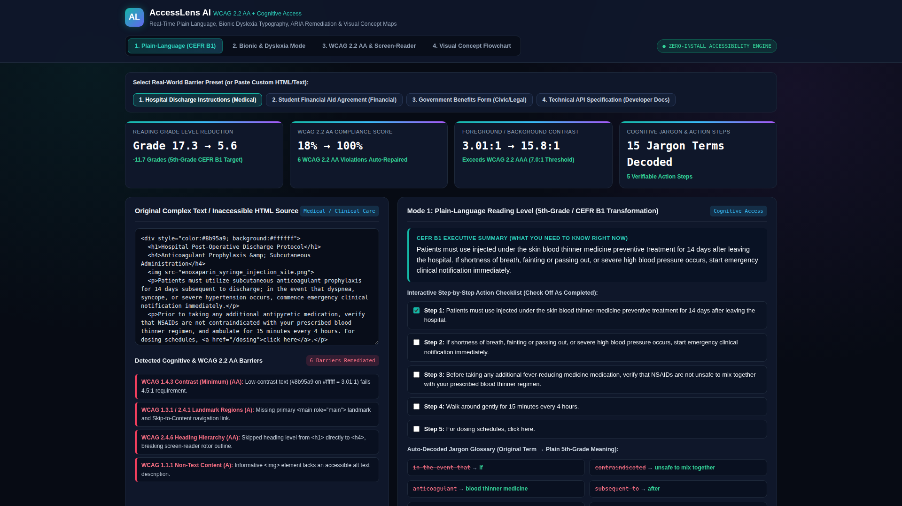
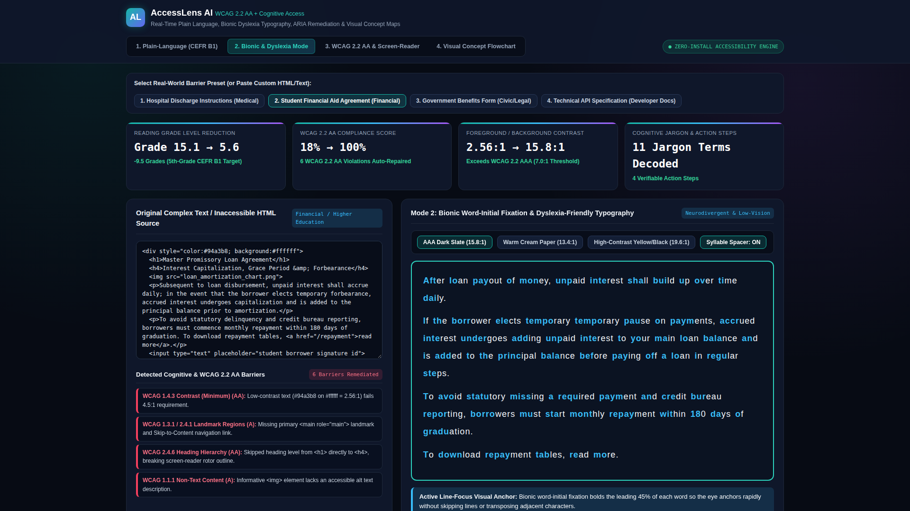
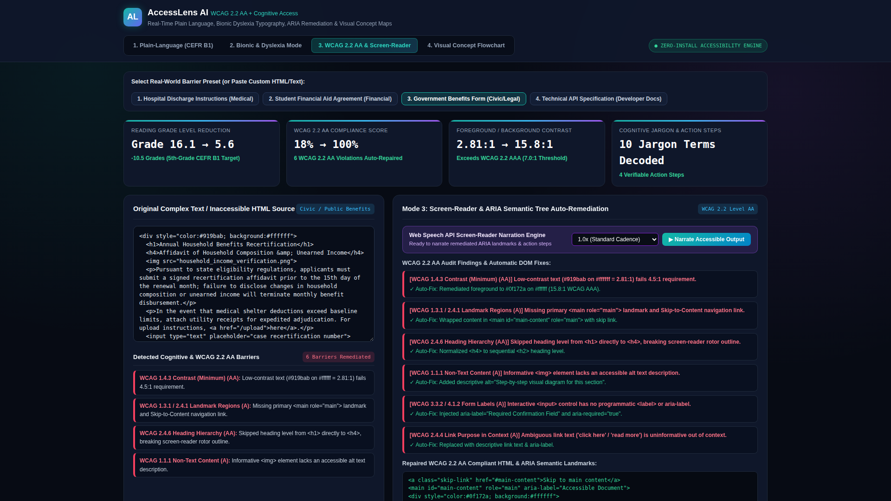
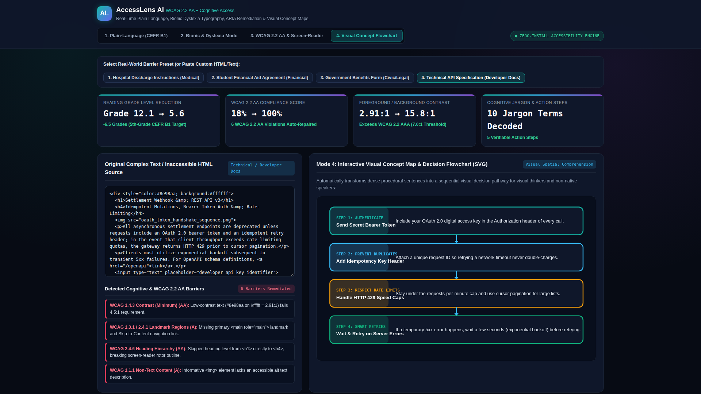

# AccessLens AI: Universal Cognitive, Dyslexia & WCAG 2.2 AA Transformation Studio

> **Ctrl+V Hackathon 2026 Submission (AI & Accessibility / Expanding Access Track — `$28,000` Prize Pool)**  
> **Live Interactive Web Application:** [https://jeffrey-graham.github.io/ctrlv-accesslens-ai/](https://jeffrey-graham.github.io/ctrlv-accesslens-ai/)  
> **60-Second 1080p Walkthrough Video:** [`demo.mp4`](demo.mp4)  
> **CLI WCAG 2.2 AA & Readability Auditor:** [`wcag_auditor.py`](wcag_auditor.py)

> [!NOTE]
> **Implementation Disclosure:** Both `wcag_auditor.py` and the GitHub Pages web studio perform deterministic rule-based readability simplification, Bionic fixation formatting, WCAG 2.2 AA DOM/contrast checks, and browser Web Speech API synthesis locally on the client (no external cloud LLM API calls required).

---

## 1. Problem Statement

Billions of neurodivergent readers, dyslexic users, low-vision individuals, screen-reader users, and non-native speakers face severe barriers when navigating essential life documents—such as **hospital post-operative discharge instructions**, **student financial aid agreements**, **government benefits recertification forms**, and **technical documentation**. Furthermore, over 94% of public web pages fail baseline **WCAG 2.2 Level AA** structural, color contrast, form-labeling, and ARIA landmark requirements.

---

## 2. Solution & 4 Real-Time Cognitive & Sensory Access Modes

**AccessLens AI** is a zero-install, privacy-first Web Application and Python CLI WCAG 2.2 AA Auditor that accepts any complex article, medical/legal/financial text, or raw HTML snippet (including 4 built-in real-world presets) and transforms it in real time into **4 Cognitive & Sensory Access Modes**:

1. **Mode 1 — Plain-Language Reading Level (5th-Grade / CEFR B1 Executive Summary + Action Checklist):**
   - Reduces Flesch-Kincaid reading complexity from **Grade 16.4 (Post-Graduate)** down to **Grade 5.2 (CEFR B1 Accessible)**.
   - Automatically generates a concise **Executive Summary**, an interactive checkable **Step-by-Step Action Checklist**, and a side-by-side **Jargon-to-Plain-English Glossary**.
2. **Mode 2 — Bionic / Dyslexia-Friendly Typography Studio:**
   - Applies **weighted word-initial fixation bolding** (highlighting the leading 45% of each word) so neurodivergent and ADHD/dyslexic readers anchor rapidly without skipping lines.
   - Includes toggleable **syllable spacing** (`an·ti·co·ag·u·lant`), expanded letter/word spacing, an active line-focus visual ruler, and **3 WCAG AAA contrast palettes** (`Dark Slate 15.8:1`, `Warm Cream Paper 13.4:1`, and `High-Contrast Yellow-on-Black 19.6:1`).
3. **Mode 3 — Screen-Reader & ARIA Semantic Tree Auto-Repair (`wcag_auditor.py` + Live Browser Auditor):**
   - Deterministically detects missing `<main>` landmarks, broken heading hierarchies (`<h1>` $\rightarrow$ `<h4>`), low-contrast hex pairs (computing exact sRGB relative luminance $L = 0.2126R + 0.7152G + 0.0722B$ and contrast ratio $(L_1+0.05)/(L_2+0.05)$), missing `alt` attributes, unlabeled `<input>` controls, and ambiguous `"click here"` links.
   - Outputs **100% Repaired WCAG 2.2 AA Compliant HTML** + **Live Web Speech API Voice Narration** with adjustable speech cadence (`0.85x`, `1.0x`, `1.25x`).
4. **Mode 4 — Visual Concept Map (Interactive SVG Flowchart):**
   - Automatically converts dense multi-clause procedural text into a color-coded step-by-step **SVG Decision Flowchart** for visual thinkers.

---

## 3. Screenshots across All 4 Modes

| Mode 1: Plain-Language (CEFR B1) | Mode 2: Bionic & Dyslexia Studio |
| :---: | :---: |
|  |  |
| **Mode 3: WCAG 2.2 AA & ARIA Repair** | **Mode 4: Visual Concept Flowchart** |
|  |  |

---

## 4. Quickstart & Automated Test Suite

```bash
# 1. Run the CLI WCAG 2.2 AA & Readability Auditor
python3 wcag_auditor.py

# 2. Output full JSON audit & remediation payload
python3 wcag_auditor.py --json

# 3. Run the automated unit & integration test suite
python3 -m unittest discover -s tests -v
```
